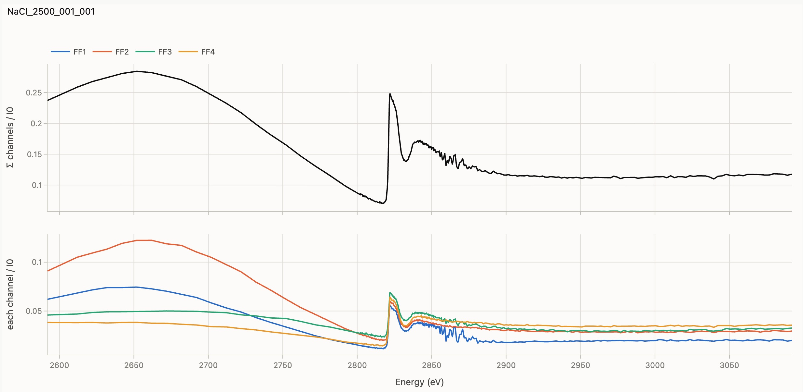
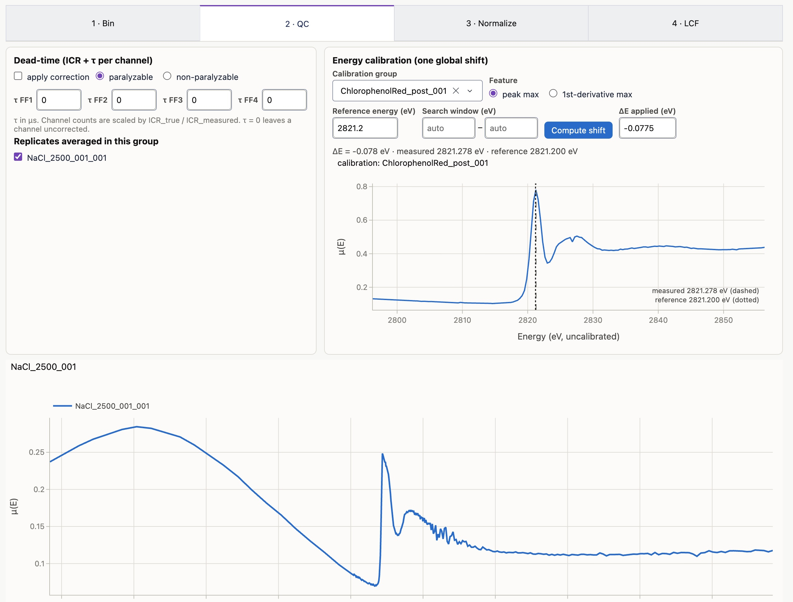
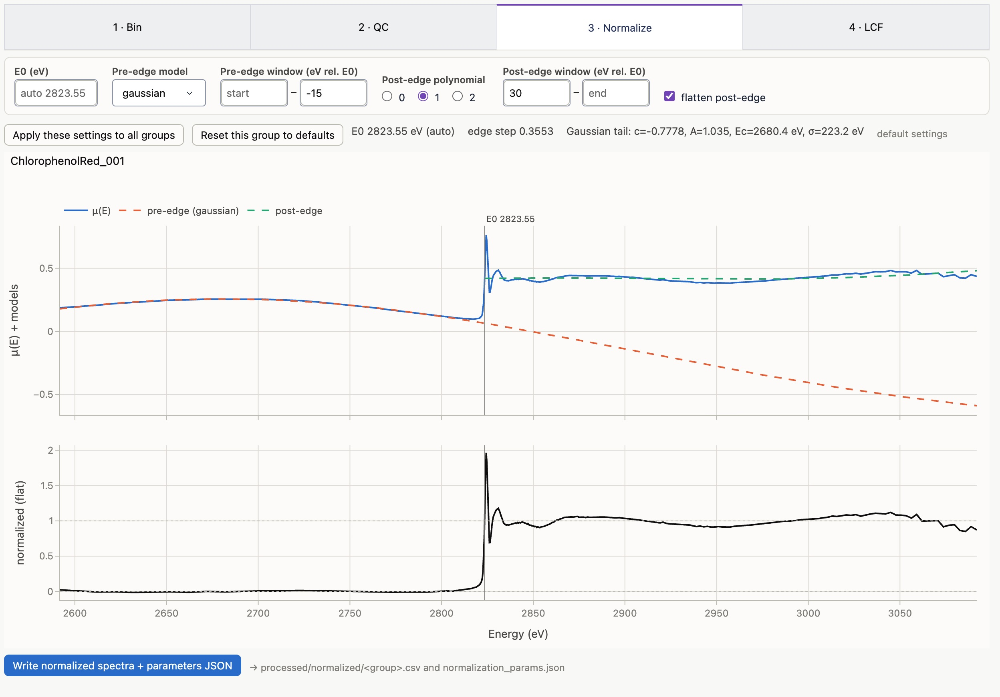

# quickXANES

A minimal XANES processing toolkit.


## Install & run

Please install using conda!

```bash
conda env create -f environment.yml      # once
conda activate quickxanes
python quickXANES.py --data YOUR_DATA_DIRECTORY # for instance, ../SSRL/bl143_nov26/xas
```

A browser tab will open at http://127.0.0.1:8050. 

Outputs go to `<data folder>/../processed/` by default . 
Use `--out` or the *Output folder* field to change that.

## Workflow

**Queue (left panel).** Every `.xdi`/`.dat` scan in the folder is listed. When the same scan exists as both, the `.xdi` is used. Ticking a row's box *selects* it. *Add selected to queue* and *Remove selected from queue* change what is analyzed: only queued files (✓; others are grayed out) go into QC, normalization and LCF. Removing one replicate drops it from its group's average. *Add all shown* queues every row that matches the filter box, *queue only* shows just the queue, and the counter shows how many files are queued. Click a row to make it the current file; *Prev/Next* step through the queue.

- **Replicates** share a *group*. Groups are suggested by reading the trailing scan counter (`name_002_001`, `name_002_002` → `name_002`). Edit a group cell to change that, or change the regex and click *Auto-group*. I've just used the default for the beamlines I've used `001, 002, etc.` but use regex as you see fit :)

- **Role** is `sample`, `standard` (used in LCF), or `calibration` (the energy-calibration standard). Set it in the table or with the buttons under the queue.

**1 · Bin.** Choose how intensity, μ(E), is built:
- *fluorescence*: Σ channels / I0
- *transmission*: ln(I0/I1)
- *column*: an existing μ column

The plot shows Σ/I0 and each channel / I0. *Fluorescence channels* sets the default for every file. To drop a channel with spurious data from **one** file, untick it under *Channels used for this file*. It's then exuded from that file's Σ everywhere downstream and drawn dotted in the plot, while other files keep all channels. *Write binned files* saves `binned/<file>.csv` (energy, raw μ, and the raw columns used).




**2 · QC.**
- **Dead-time**: per-channel τ (μs). Each channel is scaled by ICR_true/ICR_measured, with the paralyzable model ICR_meas = ICR_true·exp(−ICR_true·τ) (or the non-paralyzable one). The correction is off until you tick *apply correction*, and τ = 0 leaves a channel uncorrected. **Leave at zero if unsure, or speak with your beamline scientist!**

- **Replicates averaged**: untick a bad scan to drop it from the group average. The lower plot shows each replicate minus the average. The table lists each file's channels (e.g. "all but FF1"), gives the RMS deviation, and flags short scans.

- **Calibration**: pick the calibration group, the feature (peak max or 1st-derivative max) and its reference energy, then ick *Compute shift*. The one ΔE is applied to every scan, and you can also type ΔE by hand.

*Write* saves `qc/<group>.csv` (averaged, calibrated, dead-time-corrected μ ± std) and `qc/qc_report.csv`.



**3 · Normalize.** The pre-edge background is fit over a window and subtracted from the **whole** spectrum. The default model is **constant + Gaussian tail**, c + A·exp(−(E−Ec)²/2σ²), which models a scatter peak passing through the fluorescence window; *linear* and *constant* are also available. Points are weighted by their energy spacing, so the coarse pre-edge steps count as much as the dense edge points. A polynomial (degree 0–2) is then fit to the post-edge, and the edge step is that polynomial at E0. *Flatten* removes the post-edge curvature above E0.
- Windows are given in eV relative to E0, so they carry over between samples. E0 defaults to the derivative maximum; type a value to fix it.
- Changing a control stores settings for the current group only. *Apply these settings to all groups* makes them the defaults.

*Write* saves `normalized/<group>.csv` (energy, mu, pre_edge, post_edge, norm, flat) and `normalized/normalization_params.json`, which records every setting and fitted value.



**4 · LCF.** Every subset of the selected standards (up to *Max components*) is fit to the normalized sample using non-negative least squares. The sum of weights is **not** forced to 1, so a sum far from 1 points to a missing standard or a normalization problem.
- Fits are ranked by R-factor = Σ(data−fit)²/Σdata².
- R-factor always improves when you add a standard. *p vs simpler* is a Hamilton F-test of whether the last-added standard is justified (small p = justified). It is optimistic, because XANES points are oversampled.

*Fit all samples + write CSV* saves `lcf/lcf_results.csv`, with the top N fits per sample and a weight, error and fraction column per standard, plus `lcf/fits/<sample>_best.csv`.

## Replication

All the settings you used to QC, normalize, and fit your XANES live in one JSON file: queue, groups, roles, signal, dead-time, calibration, normalization and LCF. It's written to `processed/params/quickxanes_params.json` on every *Write* and by *Save params*. 

To reproduce every output with no app:

```bash
python quickXANES.py --params YOURDATAFOLDER/processed/params/quickxanes_params.json --run
```

To pick up where you left off in the app, use the same `--params` without `--run`.

## Files in this repo

```
quickXANES.py          entry point (app or --run)
qxanes/readers.py      .xdi, SSRL .dat, plain-column readers; column-role detection
qxanes/processing.py   μ(E), dead-time, calibration features, averaging
qxanes/normalize.py    pre-edge (Gaussian tail / linear / constant), post-edge, flatten
qxanes/lcf.py          combinatorial NNLS LCF + Hamilton test
qxanes/session.py      parameters + pipeline + file outputs (shared by app and CLI)
qxanes/plots.py        Plotly figures
qxanes/app.py          Dash UI
tests/test_core.py     synthetic known-answer tests + real-data smoke test (pytest tests)
```


# Credit
This software was written by Tristan Caro with assistance (unit testing, linting, syntax) from Claude Opus 5.5.

The methods used in this software are inspired by Sam Webb's SIXPACK software:

S. M. Webb, SIXpack: a graphical user interface for XAS analysis using IFEFFIT. Phys. Scr. 2005, 1011 (2005).

[https://www.sams-xrays.com/sixpack](https://confluence.slac.stanford.edu/spaces/SamsXRays/overview)

[https://confluence.slac.stanford.edu/spaces/SamsXRays/overview](https://confluence.slac.stanford.edu/spaces/SamsXRays/overview)


